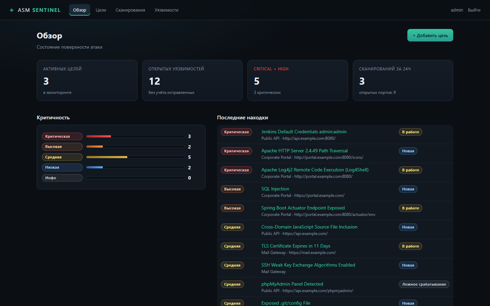
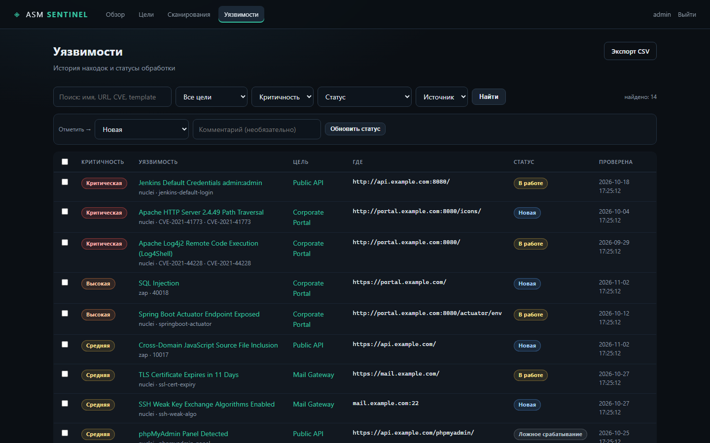
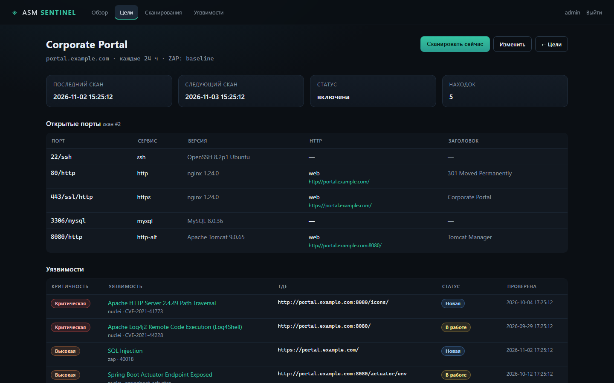
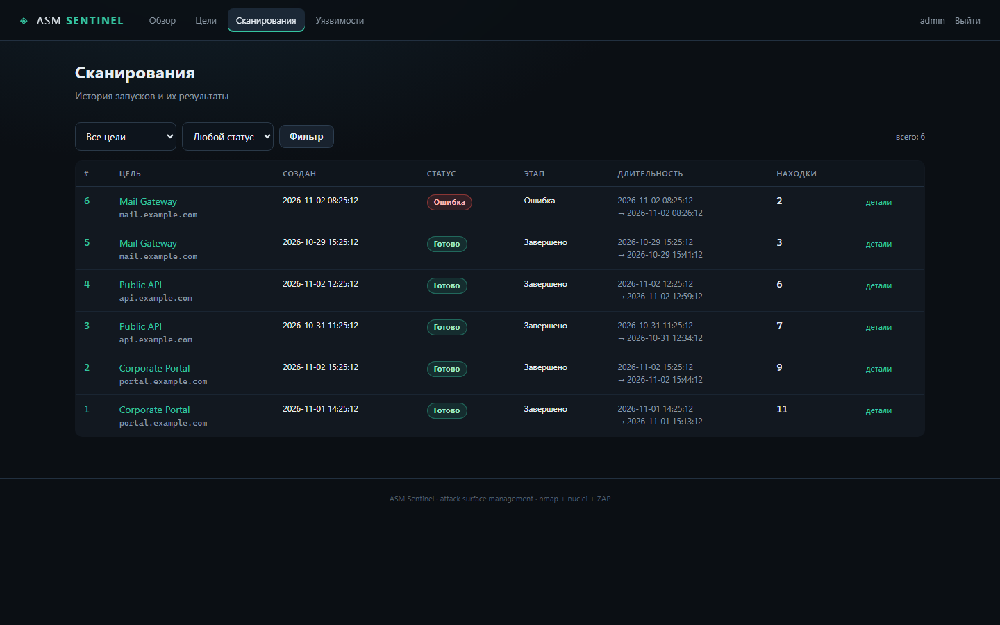
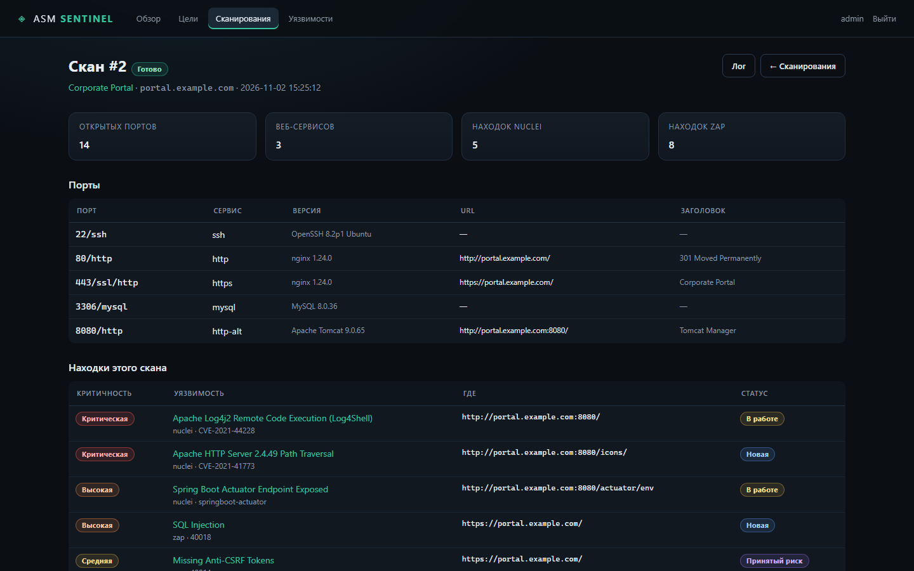

# ASM Sentinel

**Self-hosted attack surface management.** Периодически обходит ваши активы
(nmap → nuclei → ZAP), собирает открытые порты, веб-сервисы и уязвимости,
дедуплицирует находки и ведёт их жизненный цикл до исправления.

Один процесс, SQLite, никаких внешних сервисов и облаков: всё работает на вашей машине.



## Возможности

- **Цели** — домен, IP или подсеть; интервал сканирования в часах; ручной запуск.
- **Пайплайн** — `nmap -p-` → `nmap -sV` → определение HTTP(S) → `nuclei` → `zap-baseline.py` / `zap-full-scan.py`.
- **Дедупликация находок** по отпечатку, счётчик повторений, автоматическое переоткрытие исправленных.
- **Жизненный цикл**: новая → в работе → исправлена / ложное срабатывание / принятый риск.
- **История статусов** (аудит), комментарии, массовое обновление, CSV-экспорт.
- **Живой прогресс** сканирования и полный лог каждого скана.
- **Один бинарник зависимостей**: FastAPI + SQLite (WAL), планировщик внутри приложения.

## Скриншоты

| Уязвимости | Карточка цели |
|---|---|
|  |  |
| **Сканирования** | **Детали скана** |
|  |  |

## Как это работает

```
цель (домен / IP / CIDR)
        │
        ▼
nmap -Pn -p <порты>        открытые порты
        │
        ▼
nmap -sV                   сервисы и версии
        │
        ▼
HTTP(S)-проба              URL веб-интерфейсов и заголовки
        │
        ├──► nuclei        шаблоны CVE, misconfig, exposed panels
        │
        └──► ZAP           baseline / full scan веб-приложений
        │
        ▼
дедупликация по отпечатку → SQLite → веб-интерфейс
```

Сканирования выполняются последовательно в фоновом потоке (ZAP тяжёлый),
интерфейс опрашивает `/api/scans/active`.

## Требования

- Debian, Ubuntu или Kali Linux (x86_64 / arm64)
- root для установки, 2 ГБ RAM, 5 ГБ диска (ZAP + шаблоны nuclei)
- Docker — как альтернатива ручной установке

## Установка

### Быстрый старт (Linux)

```bash
curl -fsSL https://github.com/derkachartem-commits/asm-sentinel/archive/refs/heads/main.tar.gz \
  | tar -xz -C /tmp
sudo /tmp/asm-sentinel-main/install.sh
```

Инсталлятор поставит nmap, nuclei с шаблонами и OWASP ZAP, создаст
systemd-сервис, сгенерирует пароль администратора и выведет его в конце.
Повторный запуск обновляет код и зависимости, сохраняя базу, секрет и пароль.

### Из репозитория

```bash
git clone https://github.com/derkachartem-commits/asm-sentinel.git
cd asm-sentinel
sudo ./install.sh
```

Параметры инсталлятора:

| Опция | По умолчанию | Описание |
|---|---|---|
| `--port N` | `8000` | порт веб-интерфейса |
| `--bind ADDR` | `127.0.0.1` | адрес прослушивания |
| `--dir PATH` | `/opt/asm-sentinel` | каталог установки |
| `--password STR` | генерируется | пароль администратора |
| `--root` | выкл. | запускать сервис от root (nmap SYN-скан) |
| `--no-zap` | выкл. | не устанавливать ZAP |
| `--no-nuclei` | выкл. | не устанавливать nuclei |
| `--skip-deps` | выкл. | не вызывать apt-get (зависимости уже стоят) |

Примеры:

```bash
sudo ./install.sh --port 8080 --bind 0.0.0.0
sudo ./install.sh --root                 # SYN-скан -sS вместо connect -sT
sudo ./install.sh --no-zap --no-nuclei   # только nmap-разведка
```

После установки:

```bash
systemctl status asm-sentinel
journalctl -u asm-sentinel -f
cat /etc/asm-sentinel/asm-sentinel.env    # пароль и секрет, mode 600
```

### Docker

```bash
git clone https://github.com/derkachartem-commits/asm-sentinel.git
cd asm-sentinel
cp .env.example .env
# задайте ASM_ADMIN_PASSWORD в .env
docker compose up -d --build
```

Образ содержит nmap, nuclei с шаблонами и ZAP; данные — в volume `./data`.
Интерфейс слушает `127.0.0.1:8000`. Внутри контейнера процесс работает от root:
это нужно для nmap SYN-скана и ZAP.

### Ручная установка (разработка)

```bash
sudo apt-get install -y nmap zaproxy python3-venv
python3 -m venv .venv && . .venv/bin/activate
pip install -r requirements.txt
export ASM_ADMIN_PASSWORD='сильный-пароль'
export ASM_ZAP_HOME=/usr/share/zaproxy
python3 run.py
```

Открыть `http://127.0.0.1:8000` и войти под паролем администратора.

## Первый запуск

1. Войдите в интерфейс под `admin` и паролем из инсталлятора.
2. **Цели → + Добавить цель**: имя, адрес (`example.com`, `10.0.0.5`, `10.0.0.0/24`),
   интервал, режим ZAP (`baseline`, `full`, `off`).
3. Сканирование запустится автоматически в течение минуты; кнопка
   «Сканировать сейчас» запускает его вручную.
4. Найденные проблемы разбирайте в **Уязвимости**: статусы, комментарии,
   массовое обновление, экспорт CSV.

> **Перед публикацией наружу** поставьте TLS-реверс-прокси и включите
> `ASM_COOKIE_SECURE=1` — см. [docs/nginx.md](docs/nginx.md).

## Конфигурация

Переменные окружения (`/etc/asm-sentinel/asm-sentinel.env`):

| Переменная | По умолчанию | Назначение |
|---|---|---|
| `ASM_ADMIN_PASSWORD` | `changeme` | пароль администратора |
| `ASM_SECRET` | генерируется в `data/secret.key` | подпись cookie |
| `ASM_DATA_DIR` | `./data` | БД, логи, отчёты, шаблоны nuclei |
| `ASM_HOST` | `0.0.0.0` | адрес прослушивания |
| `ASM_PORT` | `8000` | порт веб-интерфейса |
| `ASM_ZAP_HOME` | `/usr/share/zaproxy` или `/opt/ZAP_2.17.0` | каталог ZAP |
| `ASM_ZAP_KEY` | из `~/.ZAP/config.xml` | API-ключ ZAP |
| `ASM_ZAP_MAX_URLS` | `5` | сколько URL проверять ZAP за скан |
| `ASM_MAX_PORTS_PER_HOST` | `300` | ограничение числа портов на хост |
| `ASM_MAX_WEB_PROBES` | `80` | сколько портов проверять HTTP-пробой |
| `ASM_COOKIE_SECURE` | `0` | `1` — cookie только по HTTPS |

## Обслуживание

```bash
# статус и логи
systemctl status asm-sentinel
journalctl -u asm-sentinel -n 100 --no-pager

# обновление
cd /opt/asm-sentinel && sudo ./install.sh    # или: git pull + ./install.sh

# резервная копия (БД, логи и отчёты)
tar czf asm-backup-$(date +%F).tgz -C /opt/asm-sentinel data

# удаление (данные сохраняются)
sudo ./uninstall.sh

# удаление вместе с данными и конфигом
sudo ./uninstall.sh --purge
```

## REST API

| Метод | Путь | Описание |
|---|---|---|
| `GET` | `/healthz` | состояние сервиса, без авторизации |
| `POST` | `/api/targets/{id}/scan` | поставить цель в очередь |
| `GET` | `/api/scans/active` | активные и ожидающие сканы |
| `GET` | `/export/findings.csv` | экспорт находок с фильтрами |

API использует ту же cookie-сессию, что и интерфейс.

## Архитектура

```
app/main.py      FastAPI: UI, REST, экспорт CSV
app/scanner.py   пайплайн nmap / nuclei / ZAP, очередь, планировщик
app/db.py        схема SQLite и доступ к данным
app/auth.py      сессия, CSRF, rate-limit логина
templates/       Jinja2 UI
static/          CSS/JS
data/            SQLite, логи сканов, отчёты (создаётся при запуске)
```

- Один экземпляр приложения: SQLite + in-process scheduler, `workers=1`.
- Планировщик проверяет расписание раз в 30 секунд.
- Перезапуск сервиса помечает незавершённые сканы как прерванные.

## Безопасность

- Сканируйте **только свои активы** или активы, на которые есть письменное разрешение.
  `zap-full-scan` — активное сканирование с атаками; `nuclei` с тегами
  `dos,fuzz,bruteforce,intrusive,payloads` отключён.
- По умолчанию сервис работает от непривилегированного пользователя `asm`
  и слушает `127.0.0.1`. `--root` включает SYN-скан, но расширяет права процесса.
- Один администратор, пароль из env-файла (mode 600), rate-limit логина,
  CSRF-токены, HttpOnly/SameSite cookie, `ASM_COOKIE_SECURE=1` за HTTPS.
- Данные не покидают машину: внешних API и телеметрии нет.

## Ограничения

- Продукт не заменяет ручной пентест: findings требуют триажа.
- ZAP `full` может быть очень долгим и шумным — включайте осознанно.
- Нет ролей и мультипользовательского режима: один администратор.
- Нет встроенного TLS: используйте nginx/Caddy перед приложением.

## Разработка

```bash
python3 -m venv .venv && . .venv/bin/activate
pip install -r requirements.txt
ASM_ADMIN_PASSWORD=dev ASM_DATA_DIR=./data python3 run.py
```

Тестовый стенд для проверки сканера — `testsite/` (`python3 -m http.server 8081`
в каталоге `testsite`).

## Лицензия

[MIT](LICENSE)
